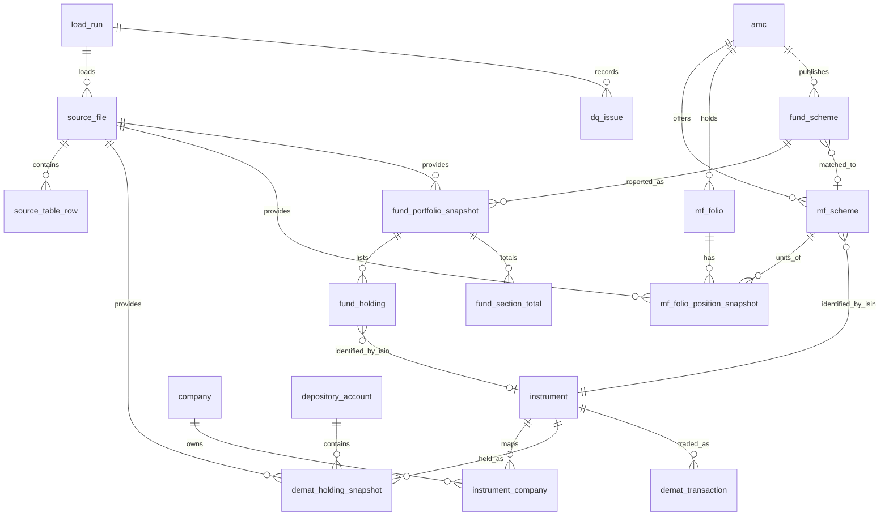

# Canonical domain model (W5) – DRAFT for review

Date: 2026-11-04
Status: Draft. Built from W2 (CAS data dictionary) and W4 (AMC layout catalogue). W4 may be revisited after this work (see §7).
Inputs: `scratch\phase1-discovery\W2-cas-field-inventory\data_dictionary_cas_DRAFT.md`; `scratch\phase1-discovery\W4-amc-layout-catalogue\W4_catalogue.md`; rules in PRD §9 and decisions W4a-1 to W4a-9 (PRD §6.2).

## 1. Principles applied
1. **Raw first, derived second (user decision).** Store the printed values as received (`*_raw` fields, with the printed unit). Store the minimum calculated values, and calculate the rest in views.
2. **Typed numerics.** Quantities, values and percentages are numeric. Footnote markers (for example `#`) are stored as NULL; the raw text stays in `raw_cell`.
3. **Holding rows only.** Only holdings-table rows create holdings. Hedging, option and swap tables go to `source_table_row` (raw) and never to holdings.
4. **Totals are checks.** Section totals and grand totals go to `section_total` and are used for reconciliation. They are never summed as holdings.
5. **ISIN as the join key, validated by format.** ISIN is 12 characters with a two-letter country code (not only `IN`). Foreign and `INF` fund ISINs are valid instruments.
6. **Idempotent loads.** A source file is identified by its SHA-256. The same file never loads twice.
7. **Traceability.** Every fact row points to a `source_file` and a `load_run`, and to the source row or cell.
8. **Privacy.** Personal identifiers are not stored (names, PAN, e-mail, address, client and DP IDs, CAS ID). See §6.

## 2. Entities

| Entity | Purpose | Natural key (unique) |
|---|---|---|
| `load_run` | One execution of the ingestion | `run_id` |
| `source_file` | One received file (CAS PDF or fund workbook) | `sha256` |
| `source_table_row` | Raw row or cell content as received, for any table, used for reconciliation and audit | `source_file_id, sheet_or_page, row_no, table_name` |
| `dq_issue` | A data-quality finding (error cell, mismatch, unknown unit, etc.) | `load_run_id, rule_code, source_file_id, location` |
| `amc` | Asset management company | `amc_code` |
| `instrument` | A security or fund unit, identified by ISIN | `isin` |
| `company` | The issuing company behind one or more instruments | `company_id` (surrogate) |
| `instrument_company` | Many-to-one link from instrument to company, with validity dates | `instrument_id, valid_from` |
| `depository_account` | A demat account at CDSL or NSDL (masked reference only) | `depository, account_ref_hash` |
| `demat_holding_snapshot` | Direct share holding at a statement date | `as_on_date, depository_account_id, instrument_id` |
| `demat_transaction` | Transactions in a demat account in the statement period | `source_file_id, depository_account_id, txn_date, instrument_id, seq_no` |
| `mf_folio` | A mutual fund folio (masked) | `amc_id, folio_ref_hash` |
| `mf_scheme` | A scheme as identified in the CAS or in the AMC file | `amc_id, scheme_code` |
| `mf_folio_position_snapshot` | Units held in a folio at a statement date | `as_on_date, mf_folio_id, mf_scheme_id` |
| `mf_transaction` | Folio transactions in the statement period | `source_file_id, mf_folio_id, txn_date, seq_no` |
| `mf_scheme_disclosure` | Commission and TER disclosure (raw only) | `source_file_id, mf_scheme_id` |
| `cas_section_total` | Summary totals as printed in the CAS (reconciliation) | `source_file_id, section_code` |
| `fund_scheme` | A scheme in an AMC portfolio workbook | `amc_id, scheme_file_code` |
| `fund_portfolio_snapshot` | One AMC workbook for one scheme and as-on date | `fund_scheme_id, as_on_date` (and `source_file_id`) |
| `fund_holding` | One holding line in a fund portfolio (holdings table only) | `fund_portfolio_snapshot_id, line_no` |
| `fund_section_total` | Section totals and grand total as printed in a workbook | `fund_portfolio_snapshot_id, section_code, label` |
| `look_through_exposure` (view, not a table) | Derived company exposure per month | derived |

## 3. Attributes

### 3.1 Load and source
- `load_run`: `run_id` (PK), `started_at`, `finished_at`, `status` (running/succeeded/failed), `parser_version`, `dependency_versions` (text), `notes`.
- `source_file`: `source_file_id` (PK), `sha256` (unique), `kind` (CAS | FUND), `original_name` (as received), `size_bytes`, `as_on_date` (read from content), `as_on_source` (cell or text location), `pages_or_sheets`, `password_source` (keyring key name only, never the value), `first_seen_run_id`.
- `source_table_row`: `source_table_row_id` (PK), `source_file_id`, `load_run_id`, `sheet_or_page`, `table_name`, `row_no` (1-based), `cells_raw` (JSON array of the printed values, unchanged), `classification` (HOLDING | SECTION_TOTAL | GRAND_TOTAL | HEDGING | OTHER).
- `dq_issue`: `dq_issue_id` (PK), `load_run_id`, `source_file_id`, `rule_code`, `location` (sheet and cell, or page), `raw_value`, `action` (NULLED | KEPT_RAW | EXCLUDED | REVIEW), `detail`.

### 3.2 Instrument and company
- `amc`: `amc_id` (PK), `amc_code`, `amc_name` (as printed, latest).
- `instrument`: `instrument_id` (PK), `isin` (unique, 12 chars, format-validated), `isin_country` (derived from first two characters), `instrument_type` (EQUITY | DEBT | MONEY_MARKET | TREPS | REIT | FOREIGN | UNLISTED | MF_UNIT | OTHER), `name_latest` (as printed in the most recent source), `face_value_raw` (CAS demat only), `face_value_unit`.
- `company`: `company_id` (PK), `company_name_canonical`, `sector` (later phase, nullable).
- `instrument_company`: `instrument_id`, `company_id`, `valid_from`, `valid_to` (nullable), `link_source` (manual | derived from name).

### 3.3 Direct holdings (CAS, demat)
- `depository_account`: `depository_account_id` (PK), `depository` (CDSL | NSDL), `dp_name` (DP name is not personal; keep), `account_ref_hash` (salted hash of the DP ID and client ID; the raw IDs are not stored).
- `demat_holding_snapshot`: `snapshot_id` (PK), `as_on_date`, `source_file_id`, `depository_account_id`, `instrument_id`, `quantity_current_raw` (int), `quantity_frozen_raw`, `quantity_pledged_raw`, `quantity_pledge_setup_raw`, `quantity_locked_in_raw`, `quantity_remat_raw`, `quantity_free_raw`, `price_raw` (numeric), `value_printed_raw` (numeric, INR). Derived in a view: `quantity_total` (sum of quantity columns, if the CAS defines it so; to confirm in W2) and `value_calc = quantity_total × price_raw`.
- `demat_transaction`: `txn_id` (PK), `source_file_id`, `depository_account_id`, `instrument_id`, `txn_date`, `particulars_raw`, `opening_qty_raw`, `credit_qty_raw`, `debit_qty_raw`, `closing_qty_raw`, `stamp_duty_raw` (numeric, INR). The "₹" and backtick variants are one field (W2-d).

### 3.4 Direct mutual funds (CAS, folios)
- `mf_folio`: `mf_folio_id` (PK), `amc_id`, `folio_ref_hash` (salted hash of the folio number; raw number not stored), `rta` (CAMS | KFIN), `holding_mode`, `ucc` (nullable).
- `mf_scheme`: `mf_scheme_id` (PK), `amc_id`, `scheme_code` (CAS scheme code), `scheme_name_latest`, `isin` (FK to instrument), `arn_code` (nullable; present in Mar and Sep).
- `mf_folio_position_snapshot`: `snapshot_id` (PK), `as_on_date`, `source_file_id`, `mf_folio_id`, `mf_scheme_id`, `units_raw` (numeric 3 dp), `nav_raw`, `cost_raw` (cumulative amount invested, INR), `value_printed_raw`, `unrealised_printed_raw`. Derived: `value_calc = units_raw × nav_raw`; `unrealised_calc = value_calc − cost_raw`.
- `mf_transaction`: `txn_id` (PK), `source_file_id`, `mf_folio_id`, `mf_scheme_id`, `txn_date`, `description_raw`, `amount_raw`, `nav_raw`, `price_raw`, `units_raw`, `stamp_duty_raw`.
- `mf_scheme_disclosure`: `disclosure_id`, `source_file_id`, `mf_scheme_id`, `ter_pct_raw`, `commission_regular_raw`, `commission_direct_raw`. Raw only; not used in look-through.

### 3.5 CAS reconciliation totals
- `cas_section_total`: `total_id` (PK), `source_file_id`, `section_code` (DEMAT_CDSL | DEMAT_NSDL | MF_FOLIOS | TOTAL_PORTFOLIO), `count_printed`, `value_printed_raw`.

### 3.6 Fund portfolio (AMC workbooks)
- `fund_scheme`: `fund_scheme_id` (PK), `amc_id`, `scheme_file_code` (the code in the workbook, for example `CF`, `MI006`, `RLMF046`), `scheme_name_latest`, `sheet_name`, `mf_scheme_id` (nullable link to the CAS scheme, set by W6 matching).
- `fund_portfolio_snapshot`: `fund_portfolio_snapshot_id` (PK), `fund_scheme_id`, `source_file_id`, `as_on_date` (from the cell or date cell named in W4), `header_row`, `isin_col`, `weight_col`, `value_col`, `weight_unit` (FRACTION | PERCENT, from the grand total row), `value_unit` (LAKHS, from the header), `grand_total_value_raw`, `grand_total_weight_raw`.
- `fund_holding`: `fund_holding_id` (PK), `fund_portfolio_snapshot_id`, `line_no` (Excel row), `section_code` (EQUITY | DEBT | MONEY_MARKET | TREPS | REIT | FOREIGN | UNLISTED | MF_UNITS | DERIVATIVE_TABLE excluded), `instrument_id` (nullable: null when no ISIN), `name_as_printed`, `industry_as_printed`, `quantity_raw`, `value_raw` (Rs. lakhs), `weight_raw` (in the unit of the workbook), `is_nested_fund` (INF ISIN, D9), `is_look_through_in_scope` (derived from D1 scope, equity only).
- `fund_section_total`: `section_total_id`, `fund_portfolio_snapshot_id`, `section_code`, `label_printed`, `value_raw`, `weight_raw`.

## 4. Relationships (ERD)

## 5. How snapshots are identified (month on month)
- A CAS snapshot is keyed by `as_on_date` (the statement date from the PDF content, not the filename) plus the depository account or folio. Re-loading the same file hits the SHA-256 unique key and is skipped.
- A fund snapshot is keyed by `fund_scheme_id` plus `as_on_date`. Each new month adds rows; no row is updated in place.
- Look-through exposure is a view over the latest snapshots of the same `as_on_date`, so direct and fund figures are compared at the same month. Fund statements are month-end; CAS dates may differ (W7 alignment rule, still to write).
- Look-through (W7 rule, equity only per D1): direct value of company X + Σ(fund holding value in X × my share of that fund). My share = my scheme value ÷ fund total. Units must match: the CAS value is in rupees (INR), the fund holding and grand total are in Rs. lakhs, so 1 lakh = 100,000 INR. Scheme value per CAS is `value_calc` above. Worked example belongs in W7.

## 6. Out of scope (personal or not needed)
| Field (W2 / W4) | Decision |
|---|---|
| Investor name, joint holder names | Not stored (personal) |
| PAN, CAS ID, address, pin code | Not stored (personal) |
| Client ID, DP ID (raw) | Not stored; only `account_ref_hash` |
| Folio number (raw) | Not stored; only `folio_ref_hash` |
| E-mail addresses (CAS mode, fund holdings) | Not stored (personal) |
| Mode of holding | Stored as text on `mf_folio` (not personal) |
| Commission and TER section | Stored raw only (`mf_scheme_disclosure`); not used in W7 |
| Risk-O-Meter columns (Canara) | Not stored; kept in `source_table_row` raw |
| YTM / YTC / YIELD columns | Not stored as analysis fields; kept in `source_table_row` raw |
| Rating / industry footnote symbols (`^`, `*`) | Industry stored as printed text; symbols kept in raw |
| Derivative tables (futures, options, swaps) | Raw only (`source_table_row`), per W4a-4 |
| Sheet width trailing empty columns | Not stored (no data) |

## 7. Coverage check: every W2 and W4 field mapped

### 7.1 W2 (CAS data dictionary)
| W2 section / field | Entity.attribute |
|---|---|
| A: statement period from / to | `source_file.as_on_date` (period end); period start kept in `source_file` raw metadata |
| A: total portfolio value | `cas_section_total.value_printed_raw` (TOTAL_PORTFOLIO) |
| A: CDSL / NSDL / MF value | `cas_section_total.value_printed_raw` |
| A: number of ISINs / schemes | `cas_section_total.count_printed` |
| A: DP name | `depository_account.dp_name` |
| A: DP ID, client ID | `depository_account.account_ref_hash` (raw not stored) |
| A: CAS ID, investor name, PAN, address | Out of scope (§6) |
| B: ISIN | `instrument.isin` |
| B: Security name | `instrument.name_latest` |
| B: Current Bal | `demat_holding_snapshot.quantity_current_raw` |
| B: Frozen Bal | `demat_holding_snapshot.quantity_frozen_raw` |
| B: Pledge Bal | `demat_holding_snapshot.quantity_pledged_raw` |
| B: Pledge Setup Bal | `demat_holding_snapshot.quantity_pledge_setup_raw` |
| B: Locked-in Bal | `demat_holding_snapshot.quantity_locked_in_raw` |
| B: Remat Bal | `demat_holding_snapshot.quantity_remat_raw` |
| B: Free Bal | `demat_holding_snapshot.quantity_free_raw` |
| B: Market Price | `demat_holding_snapshot.price_raw` |
| B: Face Value | `instrument.face_value_raw` |
| B: Value | `demat_holding_snapshot.value_printed_raw` (value_calc derived) |
| C: ISIN, Security (transactions) | `demat_transaction.instrument_id` |
| C: Transaction / Particulars | `demat_transaction.particulars_raw` |
| C: Date | `demat_transaction.txn_date` |
| C: Op. Bal / Cl. Bal | `demat_transaction.opening_qty_raw`, `closing_qty_raw` |
| C: Credit / Debit | `demat_transaction.credit_qty_raw`, `debit_qty_raw` |
| C: Stamp Duty | `demat_transaction.stamp_duty_raw` |
| D: ISIN (MF) | `mf_scheme.isin` |
| D: Folio No. | `mf_folio.folio_ref_hash` (raw not stored) |
| D: ARN Code | `mf_scheme.arn_code` |
| D: Closing Bal (Units) | `mf_folio_position_snapshot.units_raw` |
| D: NAV | `mf_folio_position_snapshot.nav_raw` |
| D: Cumulative amount invested | `mf_folio_position_snapshot.cost_raw` |
| D: Valuation | `mf_folio_position_snapshot.value_printed_raw` (value_calc derived) |
| D: Unrealised | `mf_folio_position_snapshot.unrealised_printed_raw` (unrealised_calc derived) |
| E: AMC name | `amc.amc_name` |
| E: Scheme name | `mf_scheme.scheme_name_latest` |
| E: Scheme code | `mf_scheme.scheme_code` |
| E: UCC, RTA | `mf_folio.ucc`, `mf_folio.rta` |
| E: Mode of holding | `mf_folio.holding_mode` |
| E: Email id | Out of scope (§6) |
| F: Date, description, amount, NAV, price, units, stamp duty | `mf_transaction.*` |
| G: Scheme name, ISIN, ARN (disclosure) | `mf_scheme` (already present) |
| G: TER | `mf_scheme_disclosure.ter_pct_raw` |
| G: Gross commission (Regular, Direct) | `mf_scheme_disclosure.commission_regular_raw`, `commission_direct_raw` |

### 7.2 W4 (AMC layout catalogue, one row per workbook)
| W4 field | Entity.attribute |
|---|---|
| Workbook file name | `source_file.original_name` |
| AMC | `fund_scheme.amc_id` → `amc.amc_name` |
| Sheet name | `fund_scheme.sheet_name` |
| Header row | `fund_portfolio_snapshot.header_row` |
| ISIN column | `fund_portfolio_snapshot.isin_col` (metadata) |
| Name column | `fund_holding.name_as_printed` (source column recorded in `fund_portfolio_snapshot`) |
| Industry column | `fund_holding.industry_as_printed` |
| Quantity column | `fund_holding.quantity_raw` |
| Value column | `fund_holding.value_raw` |
| Weight column | `fund_holding.weight_raw` |
| Weight label | `fund_portfolio_snapshot` (metadata) |
| Value unit | `fund_portfolio_snapshot.value_unit` |
| Weight unit | `fund_portfolio_snapshot.weight_unit` |
| Grand total row | `fund_portfolio_snapshot.grand_total_value_raw`, `grand_total_weight_raw` |
| Holding rows (ISIN count) | Derived (count of `fund_holding` rows) |
| ISIN countries | Derived from `instrument.isin_country` |
| As-on location | `source_file.as_on_source` and `fund_portfolio_snapshot.as_on_date` |
| Used and width columns | Out of scope (parser metadata; kept in load_run notes) |
| Error cells (`#VALUE!`) | `dq_issue` rows (rule code for error cells); the cell is NULL in `fund_holding` |
| Section markers | `fund_holding.section_code`; the heading text is kept in `source_table_row` |
| Nested fund unit rows | `fund_holding.is_nested_fund` |
| Derivative and hedging tables | `source_table_row` only (W4a-4) |

## 8. Points to confirm (open questions)
1. **Fund holding name column.** Whether the parser stores the name per holding or only through the instrument, given that names differ across AMCs. Proposed: keep the printed name per holding for audit; `instrument.name_latest` is a convenience.
2. **`quantity_total` in demat holdings.** The printed Value and Market Price imply a total quantity. Which columns add up to it needs confirming in W2 (section B). Until then, only the raw columns are stored.
3. **Scheme matching (W6).** `fund_scheme.mf_scheme_id` is nullable until W6 matching runs.
4. **Look-through share.** Share of a fund = folio value ÷ fund total (grand total). Needs a worked example in W7.
5. **Instrument type from the section.** A holding's type comes from its section, not from its ISIN prefix (for example, an `INF` ISIN in the MF units section). Confirm with the W4 section list.
6. **Dates.** Demat transaction and fund as-on dates are stored as dates; SBI and Mirae as-on text formats differ, so the parser must read them by type (W4a-5).

## 9. Revisit of W4 (dependency)
W5 relies on W4 fields. Gaps found while mapping, which W4 must cover before sign-off:
- The Name column is not recorded for every AMC in the catalogue (it is in the table, but the source column for name and for industry should be checked per workbook).
- The as-on date for the fund portfolio (`as_on_date`) is read from different places (text B2/B3/C4, or a date cell E5). The W4 catalogue records the cell; the parser must read the value by type.
- The weight and value columns per workbook are recorded for the holdings table only. The derivative and hedging tables need their own column maps (per W4a A15), which the catalogue does not yet hold.
- `dq_issue` rule codes for error cells, section-total mismatch (S1, S2) and unit mismatches are not yet defined (W8).
